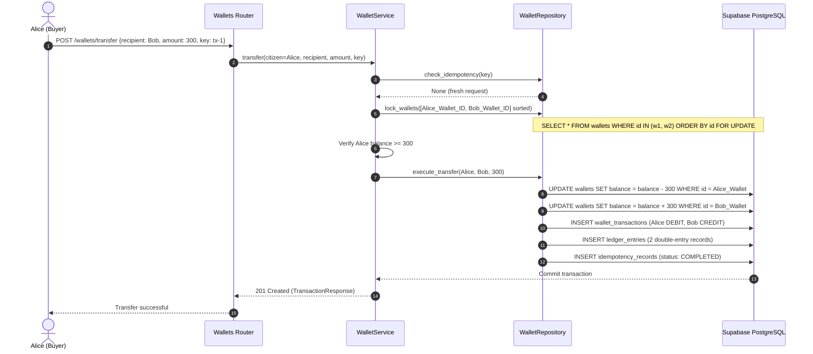

# AgriLink CIS — Wallet & Ledger Accounting Architecture

This document describes the double-entry accounting model, concurrency control, and idempotency mechanisms implemented in the Citizen Identity & Wallet Microservice.

---

## 1. Core Principles

1. **Precision**: All financial amounts use Python `Decimal` and PostgreSQL `NUMERIC(19,4)`. Floating point math is strictly forbidden.
2. **Double-Entry Balance Equation**:
   Every transfer creates two ledger entries:
   $$\text{DEBIT}_{\text{source}} + \text{CREDIT}_{\text{destination}} = 0$$
3. **Pessimistic Row-Level Locking (`SELECT ... FOR UPDATE`)**:
   Prevents race conditions, lost updates, and double-spending.
4. **Deadlock Prevention**:
   When transferring between two wallets $A$ and $B$, wallets are always locked in sorted lexicographical order:
   $$\min(UUID_A, UUID_B) \longrightarrow \max(UUID_A, UUID_B)$$
5. **No Negative Balances**:
   Enforced at the application and DB constraint layer:
   $$\text{available\_balance} \ge 0$$
6. **Dynamic Held Balances**:
   The `wallets` table stores only `available_balance`. Held balance is calculated dynamically from active records in `wallet_holds`:
   $$\text{held\_balance} = \sum_{\text{status} = 'ACTIVE'} \text{amount}$$
   $$\text{total\_balance} = \text{available\_balance} + \text{held\_balance}$$

---

## 2. Table Schemas & Relationships

```
              ┌─────────────────────┐
              │      wallets        │
              │  available_balance  │
              └──────────┬──────────┘
                         │ 1:N
       ┌─────────────────┼─────────────────┐
       ▼                 ▼                 ▼
┌──────────────┐  ┌──────────────┐  ┌──────────────┐
│wallet_trans- │  │ledger_entries│  │ wallet_holds │
│  actions     │  │  DEBIT/CREDIT│  │ active holds │
└──────────────┘  └──────────────┘  └──────────────┘
```

### 2.1 `wallets`
- `id` (UUID, PK)
- `citizen_id` (UUID, FK -> `citizens.id`)
- `currency_code` (VARCHAR(3), default `INR`)
- `status` (VARCHAR(20): `ACTIVE`, `LOCKED`, `SUSPENDED`, `CLOSED`)
- `available_balance` (NUMERIC(19,4), check `>= 0`)
- `created_at`, `updated_at`

### 2.2 `wallet_transactions`
Represents the business-level transaction (e.g. `TRANSFER`, `TOPUP`, `CASHOUT`, `HOLD`, `RELEASE`, `SETTLEMENT`):
- `id` (UUID, PK)
- `wallet_id` (UUID, FK)
- `transaction_type` (VARCHAR(30))
- `amount` (NUMERIC(19,4))
- `balance_after` (NUMERIC(19,4))
- `reference_id` (VARCHAR(100), optional external order/payout ref)
- `idempotency_key` (VARCHAR(120), unique index)
- `created_at` (TIMESTAMP)

### 2.3 `ledger_entries`
Audit trail containing immutable entry records:
- `id` (UUID, PK)
- `transaction_id` (UUID, FK -> `wallet_transactions.id`)
- `wallet_id` (UUID, FK)
- `entry_type` (`DEBIT` or `CREDIT`)
- `amount` (NUMERIC(19,4))
- `created_at` (TIMESTAMP)

### 2.4 `wallet_holds`
Escrow / temporary reserve for marketplace and rental orders:
- `id` (UUID, PK)
- `wallet_id` (UUID, FK)
- `amount` (NUMERIC(19,4))
- `status` (`ACTIVE`, `RELEASED`, `SETTLED`, `EXPIRED`)
- `hold_reason` (`ORDER_ESCROW`, `VEHICLE_RENTAL_DEPOSIT`, etc.)
- `reference_id` (external order ref)
- `expires_at` (TIMESTAMP)

---

## 3. Transfer Lifecycle Execution Flow


